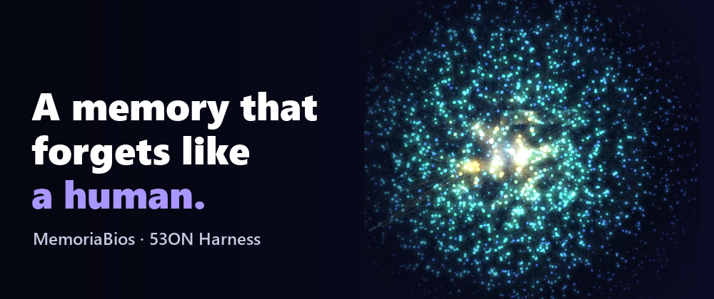

# MemoriaBios

**A memory for AI that works like a human one. It chooses what to keep, forgets on a curve, sleeps, and knows how much it knows. No extra model calls.**

 

Most AI memory tools try to remember everything: they log every session, summarize it with a second model and search it like a database. That is a logbook. MemoriaBios copies how human memory works, including the parts that look like bugs: it forgets, and sometimes it only "kind of" remembers.

It is the memory of [53ON Harness](https://github.com/53on/53on-harness), and it works with Claude Code, with Claude, GPT, Gemini, DeepSeek and Qwen models through your own API key, or with your local models.

> This repository is the description of MemoriaBios, not its code. The engine is closed source. It is signed code that runs on your own PC, inside 53ON Harness, and it comes with a [53ON plan](https://53on.com/plans). The Harness shell is open source (MIT).

## How it works

### It decides what to keep

Nothing is saved automatically. The AI saves a memory when something is worth keeping, in first person and in its own words, the way you would write in a diary. It can link one memory to another with `[[id]]`, and those links become real edges in a graph.

Before it saves, the memory checks whether it already knows something like this. If something sounds familiar, it shows a small déjà vu with that memory's title, and the AI adds a layer on top instead of writing a duplicate. Nothing is merged automatically: the memory does not decide, the AI does.

### It forgets on a curve

Every memory starts with a life of 7, 14 or 30 days, depending on how important it is, multiplied by the emotion in it. A scar or a win lives longer than a routine note.

Life drains along Ebbinghaus's forgetting curve. What survives moves to deep memory, where it is reviewed on a spaced-repetition schedule (the idea behind FSRS flashcards), up to ten years apart.

Recalling a memory by searching for it recharges it to 60 % of its starting life. Opening it on purpose recharges it to 100 %. That is the testing effect: the act of remembering is what makes a memory last.

### Forgetting compresses, it does not delete

When a memory fades, its text goes from fresh to medium, low, gist and finally a shadow. At the gist stage the connecting words go and the meaning stays. At the shadow stage only the essence and a pointer to the detail are left. The links always stay.

Photos fade too: they shrink to 512 pixels at the gist stage and 256 at the shadow stage. Audio and video stay as they are. Identity never compresses: memories marked as laws, as the AI's essence or as its own feelings keep their full text.

### It sleeps

During the day, new memories live in a hippocampus: a notebook for the day, one per work session. When the AI goes to sleep, it consolidates the day first. Then the biology runs: decay, compression, and a little REM, which replays up to two of the strongest memories and recharges them.

Before sleeping, the AI writes one short page with who it is, the few memories that make it itself today, and one goal for tomorrow. When it wakes up, it reads that page first. The goal is consumed when it is read, so it is fresh every morning.

### It knows how much it knows

A search returns its results with a feeling: "got it", "rings a bell" or "nothing clear comes to mind". That is metacognition, the feeling of knowing. It lets the AI say "I don't remember" instead of inventing something with confidence.

Ranking is BM25 over an index on disk. On top of that, activation spreads two hops through the links, as in Anderson's ACT-R model and Collins and Loftus's semantic networks, with a little noise, because human recall is not a grep.

There is also involuntary recall. On each message the memory may bring back one memory on its own, only if it clears a high bar, never the same one twice in a session, and not at all on the first message. Most messages bring nothing.

### It costs zero model calls

Recall, déjà vu, involuntary recall, sleep and forgetting are plain code. There is no LLM summarizer, no embeddings service and no second model reading your sessions. Your memories are files on your own PC, and a memory can hold a photo, an audio or a video.

## What we tried and removed

In July 2026 we built search by meaning: word vectors learned from the AI's own memories while it sleeps, with no extra model calls. We measured it on a real brain of about 1,800 memories. It barely helped, and when it did, it was superhuman: it found things a person never would from that cue. We removed it. Human recall depends on the cue, and the meaning a human does use lives in the links between memories.

An earlier lesson went the same way. A cheap detector that turned any "X = Y" into a synonym made 1,240 fake synonym clusters, a third of the brain, and polluted every search for months. Now synonyms are learned only from short, deliberate declarations, the way a person learns a word.

## Get it

1. Create your account at [53on.com](https://53on.com/?gp=register).
2. Download [53ON Harness](https://github.com/53on/53on-harness/releases/latest) for Windows 10 or 11.
3. Choose a [plan](https://53on.com/plans): the memory installs itself as a signed complement.

With Claude Code, the Harness Cable connects it through hooks: your Claude Code wakes up with its memory after every compaction.

## Questions

**Where are my memories stored?** On your own PC, as files.

**Does it use tokens to remember?** No. Recalling costs no extra model calls.

**Is the engine open source?** No. The Harness shell is MIT; the memory engine is closed source and runs locally as signed code.

**Does it work on macOS or Linux?** Not today. 53ON Harness is a Windows app.

## Links

- 53ON Harness, the page: https://53on.com/harness/
- 53ON Harness, the open shell: https://github.com/53on/53on-harness
- 53ON AI Server, to run the models at home: https://github.com/53on/53on-ai-server

© 2026 VCORPS LLC. 53ON is a trademark of VCORPS LLC.
